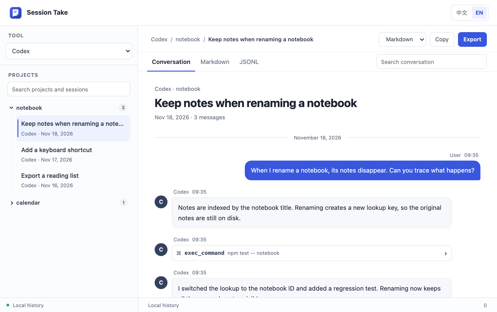

<p align="center"></p>
<h1 align="center">Session Take</h1>

<p align="center">
  
  
  <a href="LICENSE"></a>
</p>

<p align="center"><strong>English</strong> · <a href="README.zh-CN.md">简体中文</a></p>

Session Take is a macOS app that lets you take a coding conversation from one AI tool to another. It reads local sessions from Codex, DeepSeek Harness, Claude Code, Cursor, and WorkBuddy.



## Why use Session Take?

If you hit your coding plan’s usage limit halfway through a task, open the session in Session Take, select **Markdown**, and click **Copy**. Paste it into a new chat in another AI IDE and tell it where to pick up. The new chat gets the conversation, including the commands you ran and their output.

You can also look up an old fix or save a conversation for a teammate. Browsing and exporting work offline and leave the original session intact.

## Features

- **Find a session by project or title.** If a project folder has been deleted, its saved history is still accessible as long as the session files remain.
- **See what happened.** Read messages in order, expand a tool call to see its command and output, or search within the conversation for an error message.
- **Take the part you need.** Copy a single code block, or preview and export the full session in Markdown or JSONL. The Markdown and JSONL views are searchable, too.

## Install on macOS

### Download the DMG

Open **Releases** on the project’s repository page and look for a macOS `.dmg` under **Assets**. Open the downloaded file and drag **Session Take.app** to **Applications**. A filename containing `arm64` or `aarch64` is for Apple silicon. You can check your chip under **About This Mac**. The first release uses an ad hoc signature and has no Apple notarization, so macOS may block it on first launch. For Intel Macs or a local build, follow the steps below.

### Build from source

To build from source, install Node.js with npm, Rust with Cargo, and the Xcode Command Line Tools. From the repository root, run:

```sh
npm ci
npm run tauri -- build --bundles app
```

Open `src-tauri/target/release/bundle/macos/` in Finder and drag **Session Take.app** to **Applications**.

## Community and contributions

Compatibility reports are welcome. Include the source tool and version, your macOS version, and what you expected to see. A short example with private content removed is especially helpful for missing messages or tool output.

Session Take uses Tauri 2. The [TypeScript frontend](src/) handles the interface, and the [Rust backend](src-tauri/src/) reads, searches, and exports local sessions.

To work on a change, run `npm run tauri -- dev` after `npm ci`. Before submitting a patch, run:

```sh
npm run build
npm test
cargo test --locked --manifest-path src-tauri/Cargo.toml
```

Review prompts, commands, tool output, and local paths before sharing an export.

## License

Session Take is licensed under the [MIT License](LICENSE).
