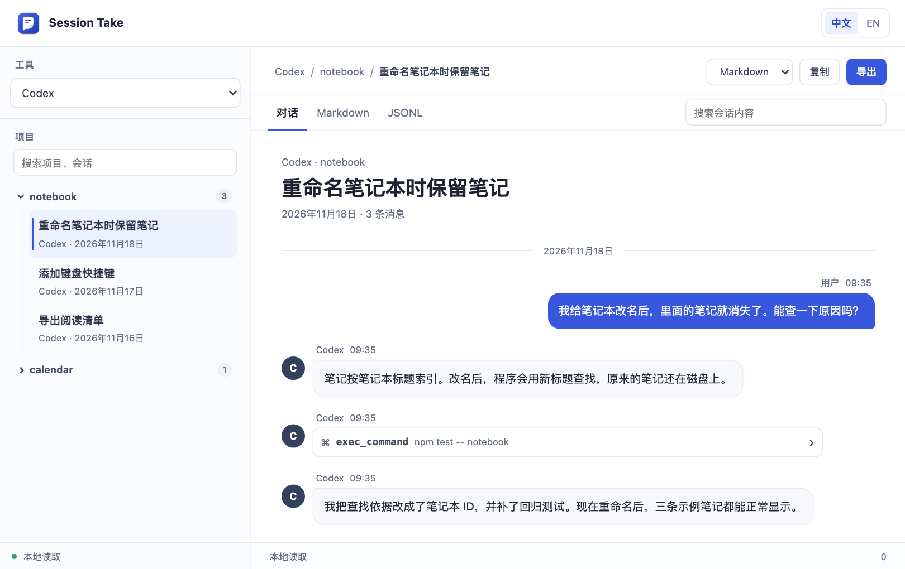

<p align="center"></p>
<h1 align="center">Session Take</h1>

<p align="center">
  
  
  <a href="LICENSE"></a>
</p>

<p align="center"><a href="README.md">English</a> · <strong>简体中文</strong></p>

Session Take 是一款 macOS 应用，可以把一个 AI 编程工具里的对话带到另一个工具继续使用。它读取 Codex、DeepSeek Harness、Claude Code、Cursor 和 WorkBuddy 保存在本机的会话。



## 为什么选择 Session Take？

任务才做到一半，当前 AI 编程套餐的额度却用完了？在 Session Take 打开这条会话，选择 **Markdown** 并点击「复制」，粘贴到另一个 AI IDE 的新对话里，告诉它从哪一步继续。之前讨论过的方案、执行过的命令和输出结果也会一起带过去。

你也可以用它找回以前解决过的问题，或把一段对话保存下来交给同事。浏览和导出都可以离线完成，原始会话保持完整。

## 功能亮点

- **按项目或标题找会话。** 即使项目目录已删除，只要会话文件仍在，就能打开历史记录。
- **回看解决问题的过程。** 按顺序阅读消息，展开工具调用查看命令和输出，也可以用一段报错文字搜索当前对话。
- **按需带走内容。** 可以只复制一段代码，也可以预览并导出整条会话的 Markdown 或 JSONL。两种格式的预览都支持搜索。

## 在 macOS 上安装

### 下载 DMG 安装

在项目仓库首页打开 **Releases**，在发行版的 **Assets** 中查找 macOS 的 `.dmg` 文件。下载并打开后，将 **Session Take.app** 拖入「应用程序」。文件名中的 `arm64` 或 `aarch64` 代表 Apple 芯片，可在「关于本机」中查看。首版安装包使用临时签名，未经 Apple 公证，macOS 首次打开时可能会拦截。如果使用 Intel Mac 或希望自行构建，可以按下方步骤编译。

### 从源码编译

从源码构建需要 Node.js 和 npm、Rust 和 Cargo，以及 Xcode 命令行工具。在仓库根目录运行以下命令。

```sh
npm ci
npm run tauri -- build --bundles app
```

在访达中打开 `src-tauri/target/release/bundle/macos/`，将 **Session Take.app** 拖入「应用程序」。

## 社区与贡献

欢迎反馈兼容性问题。请注明来源工具及其版本、macOS 版本，以及你原本期望看到的结果。遇到消息或工具输出缺失时，一小段去除隐私信息的样例有助于复现问题。

Session Take 基于 Tauri 2 构建。[TypeScript 前端](src/)负责界面交互，[Rust 后端](src-tauri/src/)负责本机会话的读取、搜索与导出。

参与开发时，先执行 `npm ci`，再用 `npm run tauri -- dev` 启动应用。提交补丁前可运行以下检查。

```sh
npm run build
npm test
cargo test --locked --manifest-path src-tauri/Cargo.toml
```

分享导出文件前，请先检查其中的提示词、命令、工具输出和本机路径。

## 许可证

Session Take 采用 [MIT 许可证](LICENSE)。
